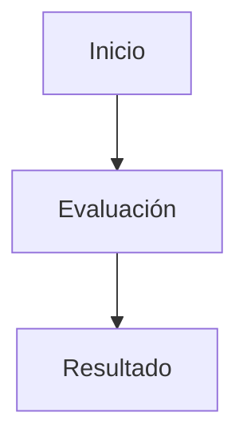
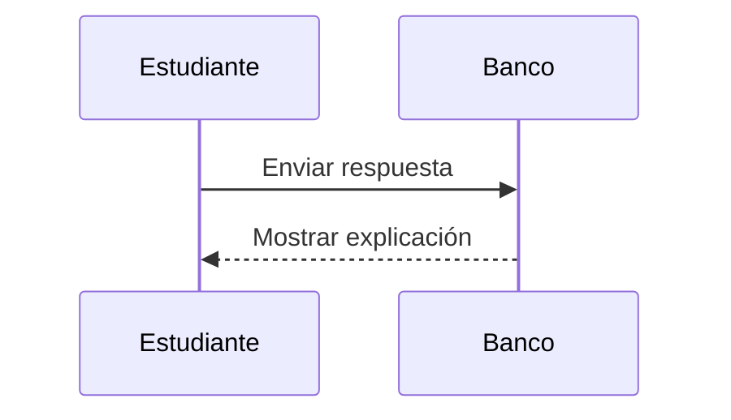
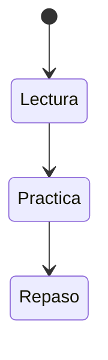

# Contrato de contenido v1

La fuente de verdad ejecutable está en `src/domain/content/types.ts`, `question-registry.ts` y `package-validator.ts`. El esquema para editores es `content/unit-package.schema.json`, generado con `pnpm content:schema`. La validación semántica de referencias y relaciones se realiza con `pnpm content:validate ruta/al/paquete.json` y al importar desde la aplicación.

## Paquete de unidad

Usa `templates/unit-package.json` como mínimo o `templates/matematicas.unit-package.json` para selección múltiple, relaciones y ordenamiento. Un paquete contiene:

- `schema_version: 1`, `kind: "unit-package"`.
- `subject`: `id`, `title`, `description`, `unit_ids`.
- `unit`: `schema_version`, `id`, `subject_id`, `title`, `revision`, `topic_ids`, `lessons` (rutas), `questions` y `answers` (nombres de archivos de origen).
- `lessons`: objetos `{ "path": "lessons/01-tema.md", "markdown": "…" }`.
- `questions`, `answers`, `sources`: listas de contenido. Los datos están embebidos: el navegador no busca los archivos nombrados en el manifiesto.

`unit.exam` es opcional: `{ "question_count": 30, "duration_minutes": 45, "quotas": { "tema": 30 } }`. Sin configuración se seleccionan hasta 30 preguntas de alcance `required`, repartidas entre los temas disponibles, y se ofrecen 45 minutos. Las cuotas son opcionales, usan IDs de temas y deben sumar `question_count`. Se toma como máximo el número disponible por cuota, sin repetición. Una unidad sin preguntas `required` no permite iniciar simulacros.

Límites: 5 MiB de JSON, 1.000 preguntas, 100 lecciones. IDs únicos por colección, rutas relativas sin `..`, todas las preguntas con exactamente una respuesta y todas las referencias a temas, fuentes, materias y unidades existentes. Las actualizaciones usan los mismos IDs e incrementan `revision`. La ampliación de tipos es aditiva en v1; clientes antiguos deben actualizarse antes de importar los nuevos tipos.

## Campos comunes de pregunta

```json
{
  "schema_version": 1,
  "id": "conjuntos-matching-001",
  "subject_id": "fundamentos-matematicos",
  "unit_id": "conceptos-basicos",
  "topic_id": "conjuntos",
  "type": "matching",
  "difficulty": "basic",
  "exam_scope": "required",
  "prompt": "Relaciona cada operación con su significado.",
  "payload": {
    "left": [{ "id": "u", "text": "Unión" }, { "id": "i", "text": "Intersección" }],
    "right": [{ "id": "comunes", "text": "Elementos comunes" }, { "id": "todos", "text": "Elementos de cualquiera" }]
  },
  "hints": [],
  "source_ids": []
}
```

La respuesta vive en `answers`:

```json
{
  "question_id": "conjuntos-matching-001",
  "solution": { "pairs": { "u": "todos", "i": "comunes" } },
  "explanation": "La unión reúne los elementos; la intersección toma los comunes."
}
```

`difficulty`: `basic`, `intermediate`, `advanced`. `exam_scope`: `required` o `optional`. El enunciado y la explicación admiten Markdown y fórmulas `$…$` o `$$…$$`. En JSON se escribe `\\` para una barra de LaTeX. Los textos de relaciones y ordenamiento son texto plano; sus enunciados sí admiten matemáticas.

## Tipos admitidos

En la tabla, un elemento es `{ "id": "a", "text": "Contenido" }`; una asignación es `{ "p": false, "q": true }`. IDs de opciones únicos y al menos dos elementos por lista.

| `type` | `payload` | `solution` | Calificación |
| --- | --- | --- | --- |
| `single_choice` | `options: elemento[]` | `correct_option_id: string` | 1 si coincide |
| `multiple_choice` | `options: elemento[]` | `correct_option_ids: string[]` | 1 por conjunto exacto, sin importar orden; 0 si falta o sobra una opción |
| `matching` | `left: elemento[]`, `right: elemento[]` | `pairs: { idIzquierdo: idDerecho }` | Proporción de pares correctos; cada derecho se usa como máximo una vez; se permiten distractores a la derecha |
| `ordering` | `items: elemento[]` en orden inicial mezclado | `ordered_ids: string[]` | 1 por orden exacto con todos los IDs una vez |
| `proposition_check` | `statement: string` | `is_proposition: boolean` | 1 si coincide; clasifica si la frase es proposición, no su verdad |
| `translation` | `bindings: { p: "significado" }`, `variables: string[]` | `formula: string` | Equivalencia semántica con referencia |
| `truth_table` | `formula`, `variables`, `row_order: "false_first_lexicographic"` | `vector: boolean[]`, `classification`, `satisfiable: boolean`, `models: asignación[]` | 50% celdas intermedias/finales, 50% clasificación |
| `equivalence` | `left: formula`, `right: formula`, `variables` | `equivalent: boolean`, `counterexamples: asignación[]` | Si equivalentes: decisión. Si no: 50% decisión, 50% contraejemplo válido |
| `sat` | `formula`, `variables` | `satisfiable: boolean`, `models: asignación[]` | Si insatisfacible: decisión. Si satisfacible: 50% decisión, 50% modelo válido |
| `entailment` | `premises: formula[]`, `conclusion: formula`, `variables` | `entailed: boolean`, `counterexamples: asignación[]` | Si se deduce: decisión. Si no: 50% decisión, 50% contraejemplo |
| `short_answer` | `evaluation: "self_assessment"` | `model_answer: string`, `rubric: [{ criterion: string, points: númeroPositivo }]` | Autoevaluación; separada de la nota automática del simulacro |

`classification`: `tautology`, `contradiction`, `contingency`. El orden de las filas comienza en todas falsas; la última variable cambia más rápido. Máximo seis variables, fórmulas de 2.048 caracteres y profundidad 32. Operadores del parser: `not`, `and`, `or`, `xor`, `->`, `<->`, y sus símbolos lógicos admitidos. Nunca se evalúa código JavaScript de los paquetes.

La importación valida estructura y referencias; no certifica la exactitud pedagógica de explicaciones o soluciones. Comprueba siempre los vectores, modelos y contraejemplos con el laboratorio o pruebas independientes antes de compartir.

## Lecciones y fuentes

Las lecciones tienen frontmatter entre `---` con `schema_version`, `id`, `subject_id`, `unit_id`, `topic_id`, `title`, `order`, `exam_scope`, `source_ids`. Consulta `templates/LECCION.md`. El parser admite este subconjunto simple, no YAML arbitrario. La navegación identifica cada lección por `topic_id`: el validador rechaza dos lecciones del mismo tema, aunque sus IDs y rutas sean distintos.

Las fuentes tienen `id`, `title`, `kind` y opcionalmente `locator`, `note`, `url`. Usa fuentes comprobables; no inventes páginas ni referencias. Una unidad ilustrativa puede declarar `sources: []` y `source_ids: []` si identifica claramente su propósito.

## Distribución

Los paquetes de `content/*.unit-package.json` se incluyen automáticamente en el build. Los importados se guardan solo en este navegador. Exportar una unidad no exporta datos personales. Los nombres de tipo, IDs y claves JSON permanecen en inglés; los rótulos de la interfaz están en español y proceden del registro común.

## Markdown académico y seguridad

El mismo renderizador se usa en lecciones, enunciados, pistas, explicaciones, respuestas modelo y opciones de selección simple/múltiple. Relaciones y ordenamientos conservan sus etiquetas de texto plano del contrato v1. Se admiten encabezados, listas anidadas/ordenadas, citas, enlaces, énfasis, negrita, tachado, separadores, tablas y listas de tareas GFM. Las citas pueden emplearse para notas informativas; no hay sintaxis especial de admoniciones.

Los encabezados de las lecciones generan un índice desplegable (niveles 1–3, identificadores únicos). Navegar por él mantiene la ruta de la app y lleva el foco al encabezado. Las tablas, fórmulas display y bloques de código admiten desplazamiento local y foco de teclado.

El HTML crudo se muestra como texto, sin `rehype-raw`. ReactMarkdown filtra protocolos de enlaces inseguros. Los enlaces HTTP(S) y relativos a protocolo se abren con `noopener noreferrer`. Las imágenes embebidas se sustituyen por su texto alternativo: importar contenido no descarga imágenes de terceros. Los enlaces externos solo se siguen por acción del estudiante. No se ejecuta el código de los ejemplos.

### Matemáticas

Se admiten `$…$` y `\(…\)` inline; `$$…$$` y `\[…\]` display. Es preferible separar las fórmulas display con líneas vacías. KaTeX admite fracciones, potencias, índices, raíces, sumatorias, integrales, matrices, `cases`, `aligned`, símbolos griegos y lógicos.

```markdown
La probabilidad es $P(A\mid B)=\frac{P(A\cap B)}{P(B)}$.
También inline: \(x_1^2 + \sqrt{y}\).

$$
\begin{aligned}
S_n &= \sum_{i=1}^{n} i \\
    &= \frac{n(n+1)}{2}
\end{aligned}
$$

\[
\begin{pmatrix} a & b \\ c & d \end{pmatrix}
\]
```

**Escapes JSON:** el archivo Markdown usa una barra; dentro de un string JSON cada barra se duplica. No se aplica una segunda decodificación al importar:

```json
{ "markdown": "Inline \\(\\frac{1}{2}\\).\n\n$$\n\\begin{cases}x+y=1\\\\x-y=0\\end{cases}\n$$" }
```

Para dólares literales inequívocos usa `\$` en Markdown y `\\$` en JSON. `$5 y $10` se mantiene como moneda; `$2$` se interpreta como matemática deliberada. No hay manera universal de desambiguar cualquier frase con dólares: escapa la moneda cuando pueda parecer una fórmula. Las fórmulas inline deben abrir/cerrar sin espacios interiores junto al delimitador y no cruzan líneas; para multilínea usa display.

Los bloques de código (incluso los llamados `math`), código inline, HTML y destinos de enlaces/imágenes no se normalizan como matemáticas. Usa una expresión completa fuera de esos elementos. Una fórmula inválida muestra “Fórmula inválida”, el original y una indicación para revisarla; el resto del contenido sigue disponible. La confianza de KaTeX está desactivada (`trust:false`), con límites de expansión y tamaño. No se admiten extensiones HTML confiables ni carga remota.

### Código

Usa bloques cercados con el lenguaje: `python`/`py`, `javascript`/`js`/`jsx`, `typescript`/`ts`/`tsx`, `json`, `sql`, `bash`/`sh`/`shell`, `c`, `cpp`/`c++`, `html`/`xml`/`svg`, `css`. El resaltado de TSX/JSX es léxico de JS/TS, no un compilador. Un lenguaje desconocido se muestra sin colorear. El código inline conserva sus acentos graves.

````markdown
```python
def cuadrado(x):
    return x ** 2
```
````

Cada bloque ofrece copia y numeración de líneas opcional, excluida del texto copiado y del lector de pantalla. Se conserva indentación, sin envolver líneas; se desplaza horizontalmente en móvil. Copiar requiere la API de portapapeles del navegador (normalmente HTTPS o localhost); si falla, se explica cómo copiar manualmente. Los bloques de más de 50.000 caracteres se presentan como texto sin resaltado para acotar el trabajo del parser.

### Mermaid

Un bloque cercado `mermaid` se dibuja al acercarse al área visible. Flowcharts/árboles, secuencia y estados están cubiertos por pruebas reales; otros tipos de Mermaid se admiten según la biblioteca instalada y pueden necesitar revisión visual específica.

````markdown





````

Usa texto y estructura; la app aplica los colores de la paleta activa. No se permite frontmatter/configuración Mermaid, directivas `%%{…}%%`, `click`, estilos personalizados, enlaces, URLs o recursos externos. Se usan `securityLevel:'strict'`, etiquetas SVG sin HTML y sanitización DOMPurify que elimina scripts, eventos, enlaces, imágenes y `foreignObject`. Límite de 20.000 caracteres y 200 conexiones. Los diagramas no son una vía para importar HTML/SVG arbitrario.

La salida se ajusta al panel; “Ampliar diagrama” permite explorar uno grande con desplazamiento local. Siempre se puede consultar el código original; errores de sintaxis y contenido restringido se muestran sin interrumpir la lección. La exportación SVG se aplaza para evitar ampliar el tratamiento de archivos activos. Añade una explicación textual junto al diagrama para estudiantes que usan lectores de pantalla.
